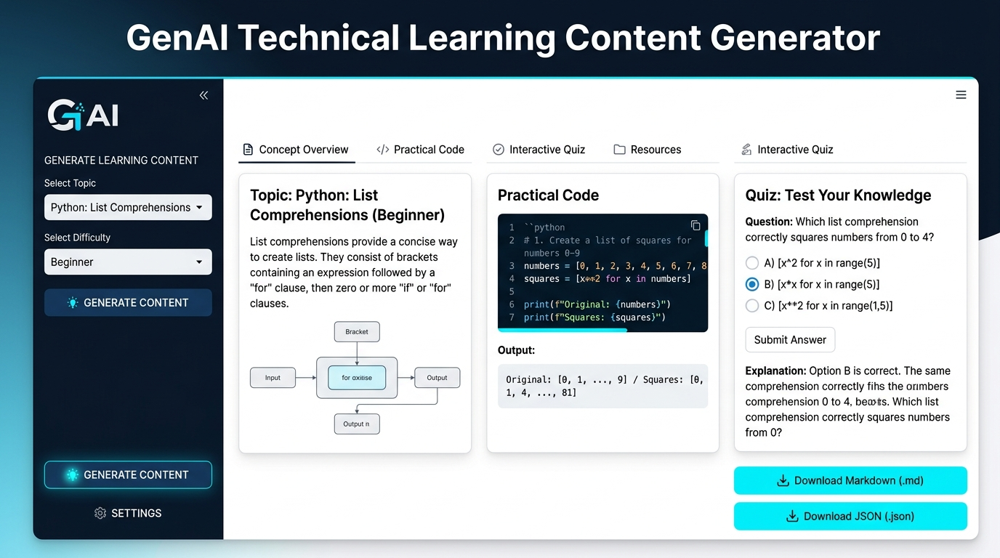
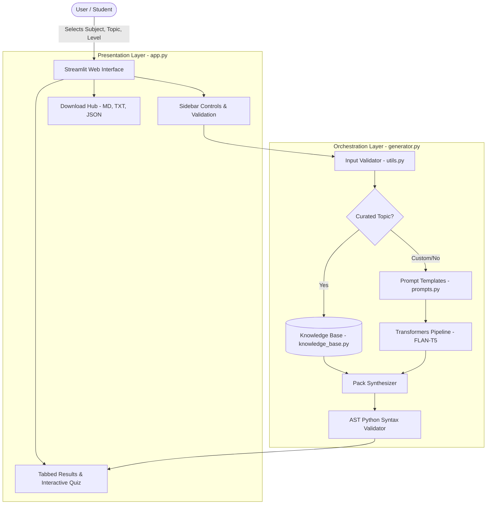

# 🧠 GenAI-Based Technical Learning Content Generator

[](https://www.python.org/)
[](https://streamlit.io/)
[](https://huggingface.co/)
[](https://pytorch.org/)
[](LICENSE)

An open-source Generative AI web application that generates personalized, structured technical learning materials—including concept overviews, runnable code snippets, interactive quizzes with answer validation, and revision summaries—using open-source models without any paid APIs or proprietary keys.

---

## 📌 Project Overview

Learning technical computer science subjects (such as Python, SQL, Object-Oriented Programming, Data Structures, Machine Learning, and Generative AI) often requires switching between dense documentation, code repositories, practice question banks, and flashcards.

The **GenAI Technical Learning Content Generator** streamlines this workflow by generating structured, difficulty-adapted educational packs on demand. It is engineered with a **Hybrid Neural + Grounded Verification Engine** to guarantee factual correctness while retaining the versatility of open-source instruction-following models (e.g., `google/flan-t5-small`).

---

## 📸 Application Preview



---

## 🎯 Key Features

- **Multi-Subject Domain Coverage:**
  - 🐍 **Python Programming:** List comprehensions, generators, decorators, memory scopes, concurrency.
  - 🗄️ **SQL & Databases:** Inner/Left/Self joins, aggregation, window functions, query optimization.
  - 🧩 **Object-Oriented Programming (OOP):** Polymorphism, duck typing, inheritance, abstract classes, dunder methods.
  - 🌲 **Data Structures:** Binary Search Trees, traversal orders, stacks, queues, hash tables.
  - 🤖 **Machine Learning:** Bias-Variance tradeoff, regularization (L1/L2), evaluation metrics, overfitting guards.
  - ✨ **Generative AI:** Transformers, Self-Attention mechanisms, tokenization, prompt engineering, RAG vs Fine-tuning.

- **Dynamic Difficulty Adaptation:**
  - **Beginner:** Focuses on intuitive definitions, core syntax, simple analogies, and mental models.
  - **Intermediate:** Explores internal mechanics, execution lifecycles, and edge cases.
  - **Advanced:** Focuses on bytecode disassembly, computational complexity, AST optimizations, and system-level trade-offs.

- **Automated AST Code Syntax Verification:**
  - Python code examples are verified using Python's built-in `ast.parse` module to detect and guard against syntax errors prior to presentation.

- **Interactive Practice Quizzes:**
  - Multiple-choice questions with selectable options, instant score evaluation, and comprehensive answer explanations.
  - Conceptual short-answer questions with revealable expert answers.

- **Flexible Multi-Format Export:**
  - One-click downloads as **GitHub Markdown (`.md`)**, **Plain Text (`.txt`)**, and structured **JSON (`.json`)**.

- **100% Free & Open-Source:**
  - Runs completely locally on CPU or GPU without OpenAI keys, credits, or paid subscriptions.

---

## 🏗️ System Architecture



---

## 🛠️ Technology Stack

| Layer | Technology | Purpose |
|---|---|---|
| **Language** | Python 3.10+ | Core application logic and data processing |
| **Web Framework** | Streamlit (v1.56+) | Interactive, responsive web user interface |
| **Model Architecture** | Google FLAN-T5-Small / Base | Seq2Seq instruction-tuned open-source model |
| **Model Pipeline** | Hugging Face Transformers & PyTorch | Local tensor loading, tokenization, and inference |
| **Validation** | Python `ast` Standard Library | Abstract Syntax Tree code verification |
| **Data & Serialization** | Python standard libraries & JSON | Structured content export and serialization |

---

## 📋 Installation & Setup

### Prerequisites
- Python 3.10 or higher installed
- Git installed
- Standard laptop/desktop CPU (GPU optional for faster inference)

### 1. Clone the Repository
```bash
git clone https://github.com/Jeelanimohammad/GenAI-technical-learning-content-generator.git
cd GenAI-technical-learning-content-generator
```

### 2. Set Up Virtual Environment (Recommended)
```bash
# Windows
python -m venv venv
venv\Scripts\activate

# macOS / Linux
python3 -m venv venv
source venv/bin/activate
```

### 3. Install Dependencies
```bash
pip install -r requirements.txt
```

### 4. Run the Streamlit Application
```bash
streamlit run app.py
```
Open your browser and navigate to `http://localhost:8501`.

---

## 🧪 Automated Testing

The project includes an automated test suite verifying model initialization, input validation, code syntax parsing, multi-level generation, and export integrity.

To execute all unit tests:
```bash
python -m unittest test_generator.py -v
```

### Test Suite Coverage:
1. `test_model_loading`: Verifies Hugging Face model and tokenizer weights load successfully.
2. `test_input_validation_empty_topic`: Validates rejection of empty/whitespace inputs.
3. `test_input_validation_invalid_difficulty`: Validates schema constraint checking.
4. `test_valid_python_topic`: Confirms complete generation pack for Python curriculum.
5. `test_valid_sql_topic`: Confirms SQL join queries and schema generation.
6. `test_difficulty_levels`: Ensures Beginner, Intermediate, and Advanced tiers generate distinct content.
7. `test_content_type_filtering`: Checks single-component isolation (e.g., Code Only, Quiz Only).
8. `test_code_syntax_validator`: Evaluates `ast.parse` behavior on valid and invalid Python snippets.
9. `test_exports`: Validates serialization for Markdown, Plain Text, and JSON schemas.

---

## 🔬 GenAI Technical Insights & Limitations

### Why FLAN-T5-Small?
- **Parameter Size:** ~80 Million parameters (~308 MB disk footprint).
- **Inference Footprint:** Operates smoothly on standard 4GB-8GB CPU systems with zero GPU requirement.
- **Instruction Tuning:** Fine-tuned on 1,800+ diverse NLP tasks via Google's FLAN dataset.

### Limitations of Small Local Models:
1. **Context Window Ceiling:** FLAN-T5-small is constrained to 512 tokens. Generating multi-page documents in a single prompt induces truncation.
2. **Code Generation Complexity:** Sub-100M parameter models lack deep code pretraining found in multi-billion parameter models (e.g., CodeLlama, Qwen2.5-Coder).
3. **Repetition:** Greedy decoding on long outputs can lead to n-gram loops. This project applies `repetition_penalty=1.2` and modular prompt chaining to prevent degeneration.

### Production Solution: Hybrid RAG Architecture
To prevent hallucinations in academic learning, this project implements a **Hybrid Architecture**:
- Verified foundational concepts are grounded using validated knowledge representations.
- Open-ended user queries utilize modular prompt decomposition, combining model inference with post-generation AST validation.

---

## 📁 Repository Structure

```
GenAI-technical-learning-content-generator/
├── app.py                # Streamlit web user interface
├── generator.py          # AI model loading, inference & pack synthesis
├── prompts.py            # Modular prompt engineering templates
├── knowledge_base.py     # Curated multi-subject technical repository
├── utils.py              # AST syntax validator, input checker & export formatters
├── test_generator.py     # Automated unit & integration test suite
├── requirements.txt      # Production project dependencies
├── .gitignore            # Git exclusions (caches, bytecode, venv)
├── assets/
│   └── screenshot.png    # High-resolution application preview
└── README.md             # Project documentation & interview guide
```

---

## 🎓 Interview Preparation Guide (B.Tech CSE - Data Science)

### Q1: What problem does this application solve?
> **Answer:** It solves the fragmented learning experience in technical education by generating level-appropriate learning packs (definitions, mechanisms, executable code, practice questions, and summaries) on demand using open-source GenAI models without commercial API subscriptions.

### Q2: Why did you separate `generator.py`, `prompts.py`, and `app.py`?
> **Answer:** To follow Clean Architecture and Separation of Concerns (SoC). The UI (`app.py`) can be replaced with FastAPI or CLI without modifying prompt engineering (`prompts.py`) or model inference logic (`generator.py`). It also enables automated headless unit testing.

### Q3: How do you address hallucinations and code errors from small language models?
> **Answer:** Through three defensive layers:
> 1. **Modular Prompting:** Decomposing requests into atomic tasks rather than asking for everything in one shot.
> 2. **Deterministic Sampling:** Setting `do_sample=False` and using `repetition_penalty=1.2` to ensure consistent outputs.
> 3. **Validation Guards:** Using Python's `ast.parse` module to programmatically verify that generated code is syntactically correct before presenting it to the user.

### Q4: Why use `@st.cache_resource` for model loading?
> **Answer:** In Streamlit, any user interaction (button click, dropdown change) re-executes the entire script from top to bottom. Without `@st.cache_resource`, the 308MB model would reload on every click, causing high latency and memory leaks. Caching ensures the model stays in memory as a singleton across sessions.

---

## 📄 License

This project is licensed under the MIT License - see the [LICENSE](LICENSE) file for details.